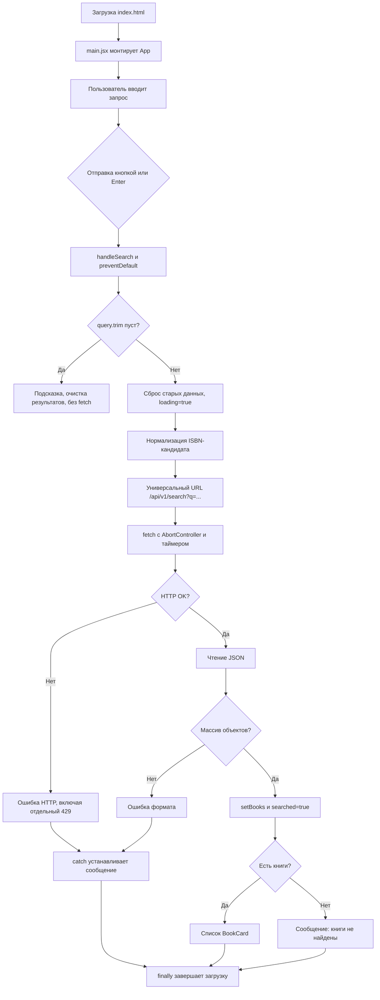

<<<<<<< HEAD
# Поиск книг

React SPA для поиска книг по названию или ISBN через публичный API Book Metadata Service. Приложение отображает результаты в карточках, обрабатывает состояния загрузки и ошибок и позволяет развернуть длинное описание

## Технологии

- React и JavaScript
- Vite
- Material UI
- Fetch API

## Запуск

```sh
npm install
npm run dev
```

Для проверки проекта доступны команды:

```sh
npm run lint
npm run build
```

Для поиска по названию и ISBN используется универсальный маршрут `/api/v1/search?q=...`. Форматированный ISBN нормализуется в приложении, а API определяет ISBN по контрольной сумме


## 1. Общая информация о проекте

### Что делает приложение

**Поиск книг** — одностраничное приложение (SPA), которое ищет книги по названию или ISBN через публичный Book Metadata Service и выводит результаты в карточках. Пользователь вводит запрос в одно поле, отправляет форму кнопкой или клавишей Enter и получает список найденных записей, сообщение об отсутствии результатов либо понятную ошибку

### Исходная задача

Разработать SPA на React, которое получает книжные метаданные от публичного API Book Metadata Service и отображает список книг карточками. В задании предусмотрены поле для названия или ISBN, отправка кнопкой и/или Enter, запрет пустого запроса, состояния загрузки, ошибки, пустого результата и успеха. В карточке показываются обложка, название, авторы, год, ISBN и краткое описание с раскрытием полного текста, если эти сведения есть в ответе. Для готовых компонентов интерфейса требуется использовать MUI

**Простыми словами:** приложение принимает запрос, передаёт его книжному сервису и оформляет ответ для чтения. Оно не хранит каталог локально и не подменяет настоящие ответы демонстрационными данными

### Реализованные возможности

- поиск по названию и ISBN в одном поле
- отправка формы кнопкой и Enter
- подсказка для пустого ввода без сетевого запроса
- индикатор загрузки и временная блокировка поля и кнопки
- раздельное отображение ошибки, пустого результата и найденных книг
- карточка с метаданными, заглушками отсутствующих полей и обложкой
- сворачивание и раскрытие описания длиной более 150 символов
- тайм-аут запроса в 10 секунд и обработка HTTP-, сетевых ошибок и неверного ответа

Тайм-аут, сообщение об ошибке HTTP 400, обработка недоступной обложки и издательство — дополнительные детали текущей реализации, а не отдельные обязательные пункты исходной задачи

## 2. Задачи и их реализация

1. Задача: SPA на React
Реализация: React монтирует `App`в один элемент страницы
Файл: `src/main.jsx`, `index.html`
Как работает: `createRoot(...).render(...)` запускает React без навигации между страницами

2. Задача: Строка поиска
Реализация: MUI `TextField`
Файл: `src/App.jsx`
Как работает: Значение поля связано с `query`

3. Задача: Поиск по названию или ISBN
Реализация: Универсальный URL `/api/v1/search?q=...`
Файл: `src/App.jsx`
Как работает: Введённый запрос кодируется и отправляется в Book Metadata Service

4. Задача: Кнопка «Найти»
Реализация: Кнопка отправки формы
Файл: `src/App.jsx`
Как работает: `type="submit"` запускает `onSubmit` формы

5. Задача: Отправка по Enter
Реализация: Стандартная отправка HTML-формы
Файл: `src/App.jsx`
Как работает: Enter в поле вызывает тот же `handleSearch`, что и кнопка

6. Задача: Пустой запрос не отправляется
Реализация: `query.trim()` и ранний выход
Файл: `src/App.jsx`
Как работает: Пустое значение или пробелы показывают подсказку и не вызывают `fetch`

7.  Задача: Состояние загрузки
Реализация: `loading`, `CircularProgress`, блокировка формы
Файл: `src/App.jsx`
Как работает:На время запроса отображается спиннер, поле и кнопка отключаются

8. Задача: Ошибка сети
Реализация: `catch` распознаёт `TypeError`
Файл: `src/App.jsx`
Как работает:Показывает сообщение о подключении к API

9. Задача: HTTP 429
Реализация: Проверка `response.status === 429`
Файл: `src/App.jsx`
Как работает: Показывает отдельное сообщение о лимите

10. Задача: Другие HTTP-ошибки
Реализация: Проверка `response.ok`, отдельная ветка 400 и общая ветка статусов
Файл: `src/App.jsx`
Как работает: Ответ с ошибочным HTTP-статусом превращается в видимое сообщение

11. Задача: Пустой результат
Реализация: `searched && books.length === 0`
Файл: `src/App.jsx`
Как работает: После успешного ответа `[]` появляется информационное сообщение

12. Задача: Список результатов
Реализация: `books.map(...)`
Файл: `src/App.jsx`
Как работает: На каждую запись создаётся `BookCard`

13. Задача: Обложка
Реализация: `CardMedia` либо placeholder
Файл: `src/bookCard.jsx`
Как работает: Отображает URL обложки или «Нет обложки»; ошибка загрузки заменяет картинку заглушкой

14. Задача: Название, автор, год, ISBN
Реализация: Значения из объекта `book`
Файл: `src/bookCard.jsx`
Как работает: Для отсутствующих или неподходящих данных показываются подписи-заглушки

15. Задача: Краткое описание с раскрытием
Реализация: Ограничение 150 символами, кнопка по состоянию `expanded`
Файл: `src/bookCard.jsx`
Как работает: Длинное описание можно развернуть и снова свернуть

16. Задача: MUI
Реализация: Готовые компоненты интерфейса
Файл: `src/App.jsx`, `src/bookCard.jsx`
Как работает: MUI оформляет поля, карточки, сообщения и индикатор

## 3. Используемые технологии

1. Технология: HTML
Что это и зачем здесь нужна: Разметка документа и точка монтирования React
Где используется: `index.html`
Если убрать или заменить: Браузеру некуда было бы загрузить и отобразить приложение

2. Технология: CSS
Что это и зачем здесь нужна: Правила расположения и размеров элементов
Где используется: `src/App.css`, `src/index.css`
Если убрать или заменить: Сохранилась бы логика React, но исчезли бы сетка карточек, отступы и адаптивная раскладка

3. Технология: JavaScript
Что это и зачем здесь нужна: Язык логики интерфейса и обработки ответа
Где используется: `src/*.jsx`, конфигурационные `.js`
Если убрать или заменить: Основная логика React-приложения перестала бы выполняться

4. Технология: React
Что это и зачем здесь нужна: Библиотека компонентов и обновления интерфейса
Где используется: `src/main.jsx`, `src/App.jsx`, `src/bookCard.jsx`
Если убрать или заменить: Пришлось бы вручную управлять DOM и состояниями

5. Технология: JSX
Что это и зачем здесь нужна: Синтаксис для описания React-интерфейса внутри JavaScript
Где используется: `.jsx`-файлы
Если убрать или заменить: Разметку пришлось бы строить иначе, например через `React.createElement`

6. Технология: React Hooks
Что это и зачем здесь нужна: Функции состояния и ссылки на данные между рендерами
Где используется: `useState`, `useRef` в компонентах
Если убрать или заменить: Состояние пришлось бы хранить и обновлять другим способом

7. Технология: Vite
Что это и зачем здесь нужна: Dev-сервер и инструмент производственной сборки
Где используется: `vite.config.js`, скрипты `package.json`
Если убрать или заменить: Нужен был бы другой сервер разработки и сборщик

8. Технология: Material UI (MUI)
Что это и зачем здесь нужна: Библиотека готовых React-компонентов
Где используется: `App.jsx`, `bookCard.jsx`
Если убрать или заменить: Пришлось бы самостоятельно заменять используемые компоненты и их стили

9. Технология: Fetch API
Что это и зачем здесь нужна: Встроенная браузерная функция для HTTP-запросов
Где используется: `handleSearch` в `src/App.jsx`
Если убрать или заменить: Понадобился бы другой HTTP-клиент; сетевое взаимодействие исчезло бы

10. Технология: REST API
Что это и зачем здесь нужна: Подход, при котором приложение обращается к ресурсам сервиса по HTTP URL
Где используется: Book Metadata Service
Если убрать или заменить: Это не установленная библиотека: без внешнего API приложение не получало бы каталог

11. Технология: npm
Что это и зачем здесь нужна: Менеджер пакетов и запускатель команд из `package.json`
Где используется: Терминал проекта
Если убрать или заменить: Нельзя было бы обычным способом установить зависимости и запустить скрипты проекта

12. Технология: ESLint
Что это и зачем здесь нужна: Статический анализатор JavaScript/JSX
Где используется: `eslint.config.js`, `npm run lint`
Если убрать или заменить: Не выполнялась бы настроенная проверка кода на ошибки и нарушения правил


### Что такое React Hooks здесь 

- `useState` хранит меняющиеся значения интерфейса: запрос, результаты, загрузку, ошибку и состояние карточки
- `useRef` хранит текущий `AbortController` без необходимости обновлять интерфейс при изменении этой ссылки

## 4. Структура проекта

Фактические важные файлы:

```text
book-search-react/
├── index.html
├── package.json
├── package-lock.json
├── vite.config.js
├── eslint.config.js
├── README.md
├── public/
│   ├── favicon.svg
│   └── icons.svg
└── src/
    ├── main.jsx
    ├── App.jsx
    ├── App.css
    ├── index.css
    ├── bookCard.jsx
    └── assets/
        ├── hero.png
        ├── react.svg
        ├── vite.svg
        └── dota.svg
```

`dist/` создаётся производственной сборкой Vite; `node_modules/` содержит установленные пакеты. Оба каталога игнорируются Git согласно `.gitignore`. В `public/` и `src/assets/` есть файлы, но `hero.png`, `react.svg`, `vite.svg` и `dota.svg` не импортируются кодом приложения. `dota.svg` подключён в HTML. Неиспользуемые ресурсы не участвуют в поиске или карточках.

1. Файл: `index.html`
Назначение и связи: HTML-документ с `lang="ru"`, заголовком страницы, favicon, viewport, элементом `#root` и подключением `/src/main.jsx`

2. Файл: `src/main.jsx`
Назначение и связи: Импортирует глобальный CSS и `App`; создаёт React root и отображает приложение в `#root`

3. Файл: `src/App.jsx`
Назначение и связи: Содержит основной компонент, состояние поиска и запросов, обработчик формы, MUI-разметку состояний и список `BookCard`

4. Файл: `src/bookCard.jsx`
Назначение и связи: Экспортирует компонент одной карточки, который получает `book` через props и отвечает за её поля, обложку и описание

5. Файл: `src/App.css`
Назначение и связи: Стили контейнера, формы, сетки карточек, изображения и мобильной раскладки

6. Файл: `src/index.css`
Назначение и связи: Базовые правила для всех элементов, страницы и шрифта

7. Файл: `package.json`
Назначение и связи: Имя и версия проекта, зависимости и команды `dev`, `build`, `lint`, `preview`

8. Файл: `package-lock.json`
Назначение и связи: Фиксирует конкретное дерево npm-зависимостей

9. Файл: `vite.config.js`
Назначение и связи: Подключает React-плагин к Vite

10. Файл: `eslint.config.js`
Назначение и связи: Задаёт правила ESLint для JavaScript/JSX и React Hooks

11. Файл: `public/favicon.svg`
Назначение и связи: Иконка страницы; путь `/favicon.svg` подключён в `index.html`

12. Файл: `README.md`
Назначение и связи: Краткая инструкция запуска и сведения о маршруте API + подробный разбор

13. Файл: `.gitignore`
Назначение и связи: Исключает из Git `node_modules`, `dist`, логи и файлы IDE


### Как соединены основные файлы

`index.html` предоставляет пустой `<div id="root">` ==> 
`main.jsx` находит этот элемент, подключает `index.css`, затем отображает `App` ==> 
`App.jsx` подключает `App.css` и импортирует `bookCard.jsx` ==> 
Для каждой книги `App` создаёт `BookCard`, а тот отображает поля с помощью MUI ==> 
`main.jsx` запускает React, `App` управляет поиском и состояниями, а `BookCard` отвечает за одну запись

## 5. Как приложение работает целиком

1. Браузер загружает `index.html`
2. В режиме разработки Vite обслуживает приложение; при публикации `npm run build` формирует статические файлы в `dist/`
3. `main.jsx` импортирует `StrictMode`, `createRoot`, `index.css` и `App.jsx`
4. React отображает `<App />` внутри элемента `#root`
5. Пользователь вводит текст; `onChange` вызывает `setQuery`
6. Пользователь отправляет форму кнопкой или Enter. Оба способа вызывают `handleSearch`
7. `event.preventDefault()` не даёт браузеру перезагрузить страницу при отправке формы
8. `query.trim()` удаляет пробелы по краям. Если строка пуста, приложение показывает подсказку, очищает результаты, помечает поиск как неуспешный и завершает обработчик без API-вызова
9. При непустом поиске очищаются предыдущая ошибка и список, сбрасывается `searched`, устанавливается `loading`
10. Ввод проверяется на форму ISBN-10/ISBN-13, включая последнюю букву `X` у ISBN-10. Разделители-пробелы и дефисы убираются для этой проверки. Контрольная сумма локально не проверяется
11. Формируется универсальный URL `https://bookmetadata.ru/api/v1/search?q=...`; параметр кодируется через `encodeURIComponent`
12. `fetch` выполняет GET-запрос с `AbortController.signal`. Таймер отменяет запрос через 10 секунд
13. Проверяется `response.ok`; HTTP 429 и 400 получают специальные сообщения, остальные неуспешные HTTP-статусы включают номер статуса
14. `response.json()` преобразует тело ответа в JavaScript-значение. Затем проверяется, что это массив объектов-книг, а не объект другого вида, `null` или массив с неправильными элементами
15. При успехе ответ записывается через `setBooks`, а `searched` становится `true`. `finally` очищает таймер и завершает загрузку для текущего контроллера
16. React повторно рендерит интерфейс. Если книг нет — показывает empty-сообщение; если книги есть — результатный заголовок и `BookCard` для каждой записи
17. В карточке пользователь может раскрыть описание длиннее 150 символов и затем свернуть его
18. При исключении `catch` выбирает сообщение по типу ошибки; пользователь может отправить новый поиск

Схема соответствует текущему обработчику:


## 6. Подробный разбор `App.jsx`

### Импорты
```jsx
import { useRef, useState } from "react";
import {
  Alert,
  Box,
  Button,
  CircularProgress,
  Container,
  TextField,
  Typography,
} from "@mui/material";

import BookCard from "./bookCard.jsx";
import "./App.css";
```

**Что делает код.** Подключает React Hooks, MUI-компоненты, карточку книги и стили компонента приложения

**По строкам.** 
- `useState` нужен для данных, меняющих интерфейс.
- `useRef` хранит ссылку на текущий запрос без отдельного рендера.
- MUI-компоненты используются ниже в JSX.
- `BookCard` импортируется из файла с фактическим именем `bookCard.jsx` (нижняя `b` важна для путей на чувствительных к регистру системах).
- `App.css` применяется к разметке

**Если убрать.** Неиспользуемые или отсутствующие импорты дадут ошибки; без `BookCard` нельзя будет отрисовать список этим компонентом

* Здесь App объединяет состояние поиска и интерфейс, а карточка одной книги вынесена в отдельный компонент

### Состояния и ссылка на активный запрос

```jsx
const [query, setQuery] = useState("");
const [books, setBooks] = useState([]);
const [loading, setLoading] = useState(false);
const [error, setError] = useState("");
const [searched, setSearched] = useState(false);
const activeRequestRef = useRef(null);
```

`useState(начальноеЗначение)` возвращает текущее значение и функцию его обновления. Компонент не должен напрямую менять значение состояния: вызов `setQuery`, `setBooks` и тп сообщает React об обновлении и вызывает новый рендер

1. Идентификатор: `query`
Начальное значение: `""`
Для чего нужен: Текст в поле ввода   

2. Идентификатор: `books`
Начальное значение: `[]` 
Для чего нужен: Массив книг из последнего успешного ответа  

3. Идентификатор: `loading`
Начальное значение: `false`
Для чего нужен: Показывает, выполняется ли запрос    

4. Идентификатор: `error` 
Начальное значение: `""`
Для чего нужен: Текст ошибки; пустая строка означает, что её нет

5. Идентификатор: `searched`
Начальное значение: `false`
Для чего нужен: Отличает начальное состояние от успешного поиска с нулём книг

6. Идентификатор: `activeRequestRef`
Начальное значение: `null`
Для чего нужен: Хранит текущий `AbortController`, чтобы блокировать повторную отправку и корректно завершать загрузку именно этого запроса 

Начальное значение `searched=false` 
пустой массив `books` до первого поиска не должен показываться как ничего не найдено

### Функция отправки формы: начало и пустой ввод

```jsx
async function handleSearch(event) {
  event.preventDefault();

  if (activeRequestRef.current) {
    return;
  }

  const searchQuery = query.trim();

  if (searchQuery === "") {
    setError("Не, так не правильно. Нужно ввести чётенькое произведение или чётенький ISBN <3");
    setBooks([]);
    setSearched(false);
    return;
  }
```

**Что делает код.** Принимает событие отправки формы и останавливает навигацию. Затем исключает повторную отправку во время активного запроса и проверяет, не состоит ли запрос только из пробелов

**По строкам**

- `async` позволяет использовать `await` внутри функции и означает, что функция возвращает Promise
- `event.preventDefault()` отменяет стандартное поведение HTML-формы — навигацию/перезагрузку страницы
- `activeRequestRef.current` содержит контроллер активного запроса. Пока он есть, функция сразу прекращает работу
- `query.trim()` убирает пробелы в начале и конце. Само значение поля при этом не меняется
- Если итоговая строка пуста, показывается подсказка, удаляются предыдущие карточки, `searched` сбрасывается. `return` гарантирует, что `fetch` не будет выполнен

**Пример** При вводе `"   "` `searchQuery` станет `""`; приложение покажет «Введите название книги или ISBN» и не обратится к серверу

**Если убрать** Без `preventDefault` форма может перезагрузить страницу
без `trim` ввод пробелов прошёл бы как запрос
без раннего `return` пустой запрос попал бы в API

* Здесь проверка на очищенный от крайних пробелов текст до сетевого запроса, поэтому пустое поле не расходует лимит API

### Сброс старых данных и переход к загрузке

```jsx
setError("");
setBooks([]);
setSearched(false);
setLoading(true);
```

Для нового непустого запроса приложение очищает старую ошибку и список, сбрасывает признак предыдущего успешного поиска и включает загрузку. Поэтому старые результаты не показываются одновременно с новой ошибкой или новым поиском

### Определение ISBN-кандидата и URL

```jsx
const normalizedISBN = searchQuery.replace(/[\s-]/g, "");
const isISBN = /^\d{9}[\dXx]$|^\d{13}$/.test(normalizedISBN);
const apiQuery = isISBN ? normalizedISBN.toUpperCase() : searchQuery;
const url = "https://bookmetadata.ru/api/v1/search?q=" + encodeURIComponent(apiQuery);
```

**Что делает код** Узнаёт строки, похожие по длине и символам на ISBN-10 или ISBN-13, нормализует такой ISBN и передаёт его в единый универсальный маршрут

**По строкам**

- `replace(/[\s-]/g, "")` удаляет все пробельные символы и дефисы из копии запроса для проверки формата
- `^\d{9}[\dXx]$` соответствует девяти цифрам и последней цифре либо `X`/`x` (ISBN-10)
- `^\d{13}$` соответствует тринадцати цифрам (ISBN-13)
- Тернарный оператор выбирает нормализованный ISBN для подходящего формата; иначе передаётся исходный `searchQuery`
- `encodeURIComponent` безопасно кодирует значение query-параметра URL. Например, пробелы и кириллица не вставляются в URL как необработанный текст

**Важно об ограничении** Это только распознавание формы строки, а не проверка контрольной суммы. Приложение не отклоняет неправильную длину: такая строка передаётся как текст для универсального поиска. API самостоятельно решает, распознать ли запрос как ISBN. Именно поэтому обычный текст, смешанный ввод и числовые строки не должны ошибочно отклоняться клиентской проверкой длины

**Пример** `978-5-389-14385-2` нормализуется в `9785389143852`; запрос `Мастер и Маргарита` сохраняется без ISBN-нормализации, но кодируется для URL

* Клиент распознаёт только форму ISBN и нормализует разделители, а контрольную сумму проверяет сам универсальный API

### Контроллер и тайм-аут

```jsx
const controller = new AbortController();
activeRequestRef.current = controller;

const timeoutId = setTimeout(() => {
  controller.abort();
}, 10000);
```

`AbortController` позволяет отменить Fetch API. Контроллер сохраняется в `ref`; `signal` передаётся запросу. Таймер через 10 000 миллисекунд вызывает `abort`. Это ограничивает время ожидания ответа, но не гарантирует, что сервер прекратил обработку запроса.

### Выполнение запроса и проверка ответа

```jsx
try {
  const response = await fetch(url, {
    signal: controller.signal,
  });

  if (!response.ok) {
    if (response.status === 429) {
      throw new Error(
        "Слишком много запросов"
      );
    }

    if (response.status === 400) {
      throw new Error(
        "API отклонил запрос, проверьте корректность запроса"
      );
    }

    throw new Error(`Ошибка сервера (HTTP ${response.status}).`);
  }

  const data = await response.json();

  if (
    !Array.isArray(data) ||
    data.some(
      (book) => !book || typeof book !== "object" || Array.isArray(book)
    )
  ) {
    throw new Error("Сервер вернул данные в неизвестном формате");
  }

  setBooks(data);
  setSearched(true);
```

**Что делает код** Ожидает HTTP-ответ, отдельно обрабатывает неуспешный статус, читает JSON и проверяет верхнеуровневый формат данных перед обновлением состояния.

- `fetch` возвращает Promise с объектом `Response`; `await` ждёт его завершения
- Fetch обычно не отклоняет Promise только из-за статусов 400 или 500. Поэтому проверяется `response.ok`
- `response.status` позволяет дать специальный текст для 429 и 400. Остальные HTTP-ошибки показывают фактический номер статуса, например 404 или 500
- `throw new Error(...)` передаёт выполнение в `catch`
- `response.json()` асинхронно разбирает JSON. Некорректный JSON вызовет `SyntaxError`
- `Array.isArray(data)` требует массив. `some` проверяет, что каждый его элемент является объектом-книгой, а не `null` или вложенным массивом
- Проверка не гарантирует наличие каждого поля `Title`, `ISBN` и т. п.; карточка отдельно обрабатывает отсутствующие поля
- При корректном ответе `setBooks(data)` записывает результаты, а `setSearched(true)` помечает успешное завершение, в том числе когда `data` — пустой массив

**Пример** HTTP 200 и тело `[]` — успешный ответ без книг, а не ошибка; код устанавливает пустой список и `searched=true`.

### Обработка ошибок и завершение

```jsx
} catch (err) {
  if (activeRequestRef.current !== controller) {
    return;
  }

  console.error("Ошибка поиска книг:", err);

  if (err instanceof Error && err.name === "AbortError") {
    setError("Сервер не ответил за 10 секунд,  повторите ЕЩЕЕЕ раз запрос");
  } else if (err instanceof TypeError) {
    setError(
      "Не удалось подключиться к API, проверьте свой не скоростной интернет"
    );
  } else if (err instanceof SyntaxError) {
    setError("Сервер вернул некорректный ответ");
  } else {
    setError(
      err instanceof Error
        ? err.message
        : "Произошла неизвестная ошибка"
    );
  }
} finally {
  clearTimeout(timeoutId);

  if (activeRequestRef.current === controller) {
    activeRequestRef.current = null;
    setLoading(false);
  }
}
```

`catch` показывает пользователю сообщения для тайм-аута, сетевой ошибки, некорректного JSON и остальных ошибок. Ошибка также записывается в консоль, поэтому она не скрывается молча. Проверка контроллера защищает состояние от обработки уже неактивного запроса. В текущем интерфейсе повторная отправка блокируется, пока запрос активен
`finally` выполняется после успеха и ошибки: он очищает таймер и только для всё ещё активного запроса сбрасывает `ref` и `loading`. Это не позволяет спиннеру остаться после завершения запроса

### Форма и условный интерфейс

```jsx
<Box component="form" onSubmit={handleSearch} className="search-form">
  <TextField
    fullWidth
    label="Введите название приколдесной кНИГИ или ISBN"
    placeholder="Например, писят два или 67"
    value={query}
    onChange={(event) => setQuery(event.target.value)}
    disabled={loading}
  />

  <Button type="submit" variant="contained" disabled={loading}>
    Найти нигу
  </Button>
</Box>
```

`Box` рендерится как HTML-форма. `onSubmit` обслуживает и кнопку, и Enter. `value={query}` вместе с `onChange` образуют контролируемое React-поле: введённое значение хранится в состоянии. На время запроса поле и кнопка отключаются через `disabled={loading}`

Основные выражения отображения:

```jsx
{loading && <Box className="loading-box">...</Box>}
{!loading && error && <Alert severity="error">{error}</Alert>}
{!loading && searched && books.length === 0 && <Alert severity="info">...</Alert>}
{!loading && books.length > 0 && <Typography>...</Typography>}
{!loading && <Box className="books-grid">{books.map(...)}</Box>}
```

`&&` означает: отрисовать правую часть, только если условие слева истинно. `error`, `loading`, `searched` и количество книг образуют интерфейсные состояния. Начальное состояние не показывает «не найдено», потому что `searched=false`

### Список и экспорт

```jsx
{books.map((book, index) => (
  <BookCard
    key={book.guid || book.ISBN || index}
    book={book}
  />
))}
```

`map` преобразует каждый объект массива в JSX-компонент. `book` передаётся как prop; `key` помогает React сопоставлять элементы списка между рендерами. Приоритет ключа — `guid`, затем `ISBN`, затем индекс, если идентификаторы отсутствуют

В конце файла:

```jsx
export default App;
```

* Компонент экспортируется по умолчанию, поэтому его импортирует `main.jsx`

## 7. Подробный разбор `bookCard.jsx`

### Props и локальные состояния

```jsx
function BookCard({ book }) {
  const [expanded, setExpanded] = useState(false);
  const [failedCoverUrl, setFailedCoverUrl] = useState("");
```

`book` — prop, то есть входные данные компонента. `App` передаёт его как `<BookCard book={book} />`. Деструктуризация `{ book }` извлекает это свойство из объекта props

- `expanded` управляет только карточкой: `false` показывает сокращённое описание, `true` — полное
- `failedCoverUrl` запоминает URL изображения, которое не загрузилось, чтобы вместо него показать заглушку

Локальные состояния нормал, потому что раскрытие описания и ошибка картинки относятся к конкретной карточке, а не ко всему поиску

### Защита отсутствующих данных

```jsx
const title =
  typeof book.Title === "string" && book.Title.trim()
    ? book.Title
    : "Эх, названия нет";
const author =
  typeof book.AuthorName === "string" && book.AuthorName.trim()
    ? book.AuthorName
    : "Эх, автор неизвестен";
const publishedYear =
  (typeof book.PublishedYear === "string" &&
    book.PublishedYear.trim()) ||
  (typeof book.PublishedYear === "number" &&
    Number.isFinite(book.PublishedYear))
    ? book.PublishedYear
    : "Эх, год издания неизвестен";
const isbn =
  typeof book.ISBN === "string" && book.ISBN.trim()
    ? book.ISBN
    : "Эх, ISBN не указан";
const publisher =
  typeof book.Publisher === "string" && book.Publisher.trim()
    ? book.Publisher
    : "Эх, издательство не указано";
const description =
  typeof book.Description === "string" && book.Description.trim()
    ? book.Description
    : "Эх, описание отсутствует";
```

Для текстовых полей проверяются тип `string` и непустое содержимое после `trim()`. Год может прийти строкой или конечным числом; поэтому число `0` не теряется из-за проверки через `||`. `Publisher` отображается как дополнительное поле текущего проекта, хотя оно не входит в обязательный перечень карточки исходного задания. Если описание отсутствует, вместо ошибки выводится описание отсутствует»

Объект API обычно содержит `AuthorName` как строку. Код не объединяет массив авторов: если сервис пришлёт массив вместо строки, будет показано не указан

### Обложка и fallback

```jsx
const coverUrl =
  typeof book.CoverUrl === "string" && book.CoverUrl.trim()
    ? book.CoverUrl
    : "";
```

```jsx
{coverUrl && failedCoverUrl !== coverUrl ? (
  <CardMedia
    component="img"
    image={coverUrl}
    alt={title}
    className="book-cover"
    onError={() => setFailedCoverUrl(coverUrl)}
  />
) : (
  <Box className="book-cover-placeholder">
    <Typography variant="body2">
      Ну тут тип обложка должна быть, но автор не добавил
    </Typography>
  </Box>
)}
```

Если URL есть и он ещё не завершился ошибкой, отображается изображение. `alt={title}` задаёт альтернативный текст для пользователей скринридеров и при недоступном изображении. `onError` обновляет локальное состояние при ошибке загрузки; следующее отображение заменяет картинку на placeholder. Если `CoverUrl` отсутствует или пуст, сразу используется заглушка

### Поля карточки

```jsx
<Typography variant="h6" component="h2">{title}</Typography>

<Typography color="text.secondary">Автор АКА крутой перец: {author}</Typography>

<Typography>Год издания невероятен: {publishedYear}</Typography>

<Typography>ISBN ваще четкий: {isbn}</Typography>

<Typography>Издательство пушечка: {publisher}</Typography>
```

`Typography` — MUI-компонент текста. `variant="h6"` задаёт визуальный стиль названия, `component="h2"` — семантический HTML-заголовок. Остальные значения берутся из подготовленных переменных, поэтому карточка остаётся читаемой при пропусках

### Обрезка и раскрытие

```jsx
<Typography className="book-description">
  {expanded
    ? description
    : description.length > 150
      ? description.slice(0, 150) + "..."
      : description}
</Typography>

{description.length > 150 && (
  <Button
    onClick={() => setExpanded(!expanded)}
    size="small"
    aria-expanded={expanded}
  >
    {expanded ? "Сверни меня" : "Разверни меня"}
  </Button>
)}
```

Если `expanded` истинен, выводится весь текст. Иначе при длине больше 150 символов вызывается `slice(0, 150)`, который берёт символы с индексами от 0 до 149, и добавляется многоточие. При коротком тексте он показывается целиком. Кнопка существует только для длинного описания. Нажатие переключает состояние через `setExpanded(!expanded)`, а надпись и `aria-expanded` сообщают текущее состояние

Компонент завершается `export default BookCard`, после чего `App.jsx` может его импортировать

## 8. Подробный разбор API

### Термины и фактический маршрут

API — программный интерфейс, через который клиент запрашивает данные у другого сервиса
REST — распространённый подход к HTTP API, где адрес обозначает ресурс, а HTTP-метод задаёт действие
HTTP-запрос — сообщение браузера серверу; `GET` обычно используется для чтения данных
URL — адрес ресурса и параметров запроса

Документация Book Metadata Service описывает универсальный маршрут:

```text
GET https://bookmetadata.ru/api/v1/search?q=<запрос>
```

Это единственный маршрут поиска, который использует текущий код. Он подходит для одного поля ввода и позволяет сервису определить по контрольной сумме, похож ли текст на ISBN. В `App.jsx` URL строится конкатенацией базовой части и `encodeURIComponent(apiQuery)`

Query-параметр `q` находится после `?` и содержит поисковую строку. Например:

```text
https://bookmetadata.ru/api/v1/search?q=Мастер%20и%20Маргарита
```

Кириллица и пробелы кодируются, чтобы строка корректно передавалась как часть URL

### HTTP-ответы и JSON

- **200** — запрос успешно обработан. Тело поиска ожидается как JSON-массив записей, в том числе пустой `[]`
- **400** — API сообщает о некорректном запросе, например о недействительном ISBN. Приложение показывает отдельное общее сообщение для 400
- **404** — ресурс не найден. Приложение отобразит общую ошибку с фактическим HTTP-кодом. В документации публичного поиска этот код не указан как обычный ответ поиска
- **429** — превышен лимит частоты запросов. По заданию это 60 запросов в минуту с одного IP; код показывает специальное сообщение и не пытается автоматически повторять запрос
- **500** — внутренняя ошибка сервера; код сообщает «Ошибка сервера (HTTP 500)»

JSON — текстовый формат обмена данными. `await response.json()` разбирает JSON в объект JavaScript или массив. Затем код проверяет массив и каждый его элемент. Невалидный JSON вызывает ошибку разбора и попадает в обработчик `SyntaxError`

Публичная документация описывает поля записи, среди которых `guid`, `Title`, `Subtitle`, `AuthorName`, `Publisher`, `PublishedYear`, `ISBN`, `ISBN13`, `CoverUrl`, `Genre`, `Description` и дополнительные сведения. Приложение использует `guid`/`ISBN` для React key и отображает `Title`, `AuthorName`, `PublishedYear`, `ISBN`, `Publisher`, `CoverUrl`, `Description`. Поля могут отсутствовать или быть `null`; карточка подставляет понятный текст. Не все перечисленные поля API отображаются интерфейсом

### Поиск по названию и ISBN

В приложении **нет двух различных URL поиска**: оба случая отправляются через `/api/v1/search?q=...`. Перед отправкой код проверяет форму ISBN-10/ISBN-13. Если запрос похож на ISBN, приложение убирает пробелы/дефисы и приводит `X` к верхнему регистру. Если нет — передаёт исходный очищенный по краям текст. Контрольную сумму и окончательную классификацию выполняет универсальный API

В документации сервиса также есть специализированные маршруты `/api/v1/search/title?q=...` и `/api/v1/search/isbn/{isbn}`, но текущий код их не вызывает

### Лимит, CORS и сетевые ошибки

Лимит 60 запросов/мин означает ограничение для одного IP-адреса за минуту. Пустой ввод не отправляется, а форма блокируется на время текущего запроса — это помогает не тратить запросы зря. Однако автоматического счётчика лимита или очереди запросов в проекте нет

CORS — браузерная политика, которая разрешает серверу указывать, с каких источников можно читать ответ. Если сервер не выставляет допустимый CORS-заголовок, браузер может запретить JavaScript прочитать ответ, даже если сервер доступен. Ошибка `fetch` не доказывает, что API выключен: причиной могут быть сеть, DNS, TLS, CORS, расширение браузера или временный сбой

Во время аудита API отвечал с `Access-Control-Allow-Origin: *`, а прямой браузерный `fetch` получил HTTP 200. Это наблюдение относится к моменту проверки, а не гарантирует постоянную доступность API

## 9. Подробное объяснение состояний приложения

Состояния представлены несколькими переменными React, а не единым enum. Отображаемое состояние вычисляется по их сочетанию.

1. Состояние: Начальное
Условние возникновения: После первого рендера: `loading=false`, `error=""`, `searched=false`, `books=[]`
Изменяемые данные: Начальные значения в `useState`
Отображение: Заголовок и форма; нет сообщения об ошибке и пустом результате
Завершение состояния:Пользователь вводит и отправляет запрос

2. Состояние: Некорректный пустой ввод
Условние возникновения: `query.trim() === ""`
Изменяемые данные: `error` задаётся подсказкой, `books=[]`, `searched=false`
Отображение: Сообщение ошибки/подсказки
Завершение состояния:Новый непустой поиск сбросит ошибку; новый пустой ввод покажет ту же подсказку

3. Состояние: Loading
Условние возникновения: После проверки непустого запроса до завершения активного запроса
Изменяемые данные: Сбрасываются `error`, `books`, `searched`; `loading=true`
Отображение: Спиннер; поле и кнопка отключены; прочие статусы скрыты
Завершение состояния: `finally` устанавливает `loading=false` для активного контроллера

4. Состояние: Success с результатами
Условние возникновения: HTTP успешен, JSON имеет ожидаемую структуру, `books.length > 0`
Изменяемые данные: `books=data`, `searched=true`
Отображение: Количество результатов и карточки
Завершение состояния: Следующий поиск очищает старые карточки

5. Состояние: Empty
Условние возникновения: HTTP успешен, массив пуст, `searched=true`
Изменяемые данные: `books=[]`, `searched=true`
Отображение: Информационное сообщение «По вашему запросу книги не найдены»
Завершение состояния: Следующий поиск сбрасывает `searched` и сообщение

6. Состояние: Error запроса
Условние возникновения: HTTP-ошибка, сеть, тайм-аут, JSON или структура некорректны
Изменяемые данные: В `catch` устанавливается `error`; `finally` завершает загрузку
Отображение: Alert с сообщением
Завершение состояния: Повторный непустой поиск сначала очищает ошибку

* Старые карточки очищаются до отправки, поэтому ошибка не отображается одновременно с результатами прошлого запроса. Empty отличается от error: пустой массив — корректный успешный ответ, ошибка — неуспешный запрос или неверный ответ. При исходном рендере сообщение empty не показывается из-за `searched=false`

## 10. Подробный разбор CSS

### `src/index.css`

```css
* {
  box-sizing: border-box;
}

html,
body {
  margin: 0;
  min-height: 100%;
}

body {
  font-family: Arial, sans-serif;
  background-color: #f5f5f5;
}
```

- `*` выбирает все элементы; `box-sizing: border-box` включает рамки и внутренние отступы в заданные размеры
- `html, body` сбрасывают стандартный внешний отступ браузера и задают минимальную высоту
- `font-family` задаёт базовый шрифт, `background-color` — светлый фон
- Здесь нет правила `min-width`, принудительно расширяющего страницу; на узком экране это помогает избежать горизонтального переполнения

### `src/App.css`

- `#root` занимает ширину и минимум высоту окна
- `.app-container` задаёт вертикальные отступы основного MUI Container
- `.app-header` центрирует заголовок и задаёт нижний отступ
- `.search-form` — flex-форма с промежутком `gap`, выравниванием, максимальной шириной и автоматическими боковыми отступами
- `.search-form button` задаёт минимальные высоту и ширину кнопки
- `.loading-box` использует `display: flex`, вертикальное направление `flex-direction: column`, центрирование и `gap`
- `.status-message` ограничивает ширину Alert и центрирует его
- `.results-title` задаёт нижний отступ; `!important` переопределяет стиль MUI
- `.books-grid` использует `display: grid`; `repeat(auto-fill, minmax(280px, 1fr))` автоматически размещает карточки минимум от 280 px, заполняя доступное место. `gap` задаёт расстояние между строками и колонками
- `.book-card` задаёт высоту карточки
- `.book-cover` и `.book-cover-placeholder` задают область обложки высотой 260 px. `object-fit: contain` вписывает обложку, сохраняя её пропорции, без обрезания
- `.book-description` добавляет верхний отступ и `overflow-wrap: anywhere`, чтобы длинное слово не расширяло карточку
- В `@media (max-width: 600px)` уменьшается верхний отступ, сетка становится одной колонкой, заголовок меньше, форма складывается вертикально и кнопка растягивается на ширину формы

Размеры, цвета, тени и базовая типографика MUI-компонентов в основном задаются Material UI; CSS проекта меняет только перечисленные классы. В проекте нет специальных анимаций.

## 11. Разбор Material UI

Material UI поставляет готовые React-компоненты интерфейса. Он не заменяет React, не хранит состояние поиска и не отправляет API-запросы.

1. Компонент: `Container`
Где используется: `App.jsx`
Что отображает и свойства: Ограничивает ширину и центрирует основное содержимое; используется `maxWidth="lg"`

2. Компонент: `Box`
Где используется: `App.jsx`, `bookCard.jsx`
Что отображает и свойства: Универсальная обёртка MUI; `component="form"` делает её HTML-формой

3. Компонент: `Typography`
Где используется: В обоих компонентах
Что отображает и свойства: Текст и заголовки; `variant` задаёт визуальный стиль, `component` — HTML-семантику

4. Компонент: `TextField`
Где используется: `App.jsx`
Что отображает и свойства: Подписанное поле поиска; `value`, `onChange`, `disabled`, `label`, `placeholder`

5. Компонент: `Button`
Где используется: `App.jsx`, `bookCard.jsx`
Что отображает и свойства: Отправка формы и переключение описания; `type`, `variant`, `disabled`, `size`, `onClick`

6. Компонент: `Alert`
Где используется: `App.jsx`
Что отображает и свойства: Видимое сообщение; `severity="error"` или `"info"`

7. Компонент: `CircularProgress`
Где используется: `App.jsx`
Что отображает и свойства: Индикатор загрузки; имеет доступную подпись через `aria-label`

8. Компонент: `Card`
Где используется: `bookCard.jsx`
Что отображает и свойства: Визуальный контейнер книги

9. Компонент: `CardContent`
Где используется: `bookCard.jsx`
Что отображает и свойства: Внутренняя область текста карточки

10. Компонент: `CardMedia`
Где используется: `bookCard.jsx`
Что отображает и свойства: Отображает изображение; `component="img"`, `image`, `alt`, `onError`

## 12. Подробный разбор пользовательских действий

1. Действие: Ввод текста
Код и последовательность: `TextField.onChange` вызывает `setQuery(event.target.value)`
Результат и возможная проблема: React обновляет значение поля; запрос пока не отправляется

2. Действие: Нажатие «Найти»
Код и последовательность: Кнопка `type="submit"` отправляет форму и вызывает `handleSearch`
Результат и возможная проблема: Запускается общая логика поиска

3. Действие: Enter
Код и последовательность: Нативная отправка HTML-формы вызывает тот же `onSubmit`
Результат и возможная проблема: Отдельный обработчик Enter не нужен

4. Действие: Пустая строка или пробелы
Код и последовательность: `trim`, установка подсказки, очистка `books`, ранний `return`
Результат и возможная проблема: Нет `fetch`; предыдущие карточки скрываются

5. Действие: Непустой запрос
Код и последовательность: Сброс старых данных, `loading=true`, построение URL, `fetch`
Результат и возможная проблема: Спиннер и disabled-поле; после успеха появляются результаты

6. Действие: Название
Код и последовательность: Формат ISBN не подходит; в `q` передаётся исходный `searchQuery`
Результат и возможная проблема: API ищет по названию; найденные книги становятся карточками

7. Действие: ISBN-13 или ISBN-10 с X
Код и последовательность: Удаляются пробелы/дефисы, форма подходит regex, `X` переводится в верхний регистр
Результат и возможная проблема: Нормализованный ISBN отправляется в универсальный `q`; контрольную сумму решает API

8. Действие: Неправильная длина ISBN-подобного текста
Код и последовательность: Regex не распознаёт ISBN-кандидат; строка остаётся обычным запросом
Результат и возможная проблема: Она передаётся универсальному поиску; клиент не показывает отдельную ошибку длины

9. Действие: Пустой результат
Код и последовательность: API возвращает `[]`; `searched=true`
Результат и возможная проблема: Появляется «По вашему запросу книги не найдены», это не ошибка HTTP

10. Действие: Ошибка API
Код и последовательность: Проверка `response.ok` или исключение переводит выполнение в `catch`
Результат и возможная проблема: Alert с ошибкой; результаты нового поиска уже очищены

11. Действие: Повторный поиск
Код и последовательность: Новый непустой ввод вызывает сброс `error`, `books` и `searched`
Результат и возможная проблема: Старое сообщение/карточки не конфликтуют с новыми результатами

12. Действие: Повторная отправка во время загрузки
Код и последовательность: Поле и кнопка disabled; дополнительно проверяется `activeRequestRef.current`
Результат и возможная проблема: Второй запрос не запускается обычным действием пользователя

13. Действие: Раскрытие описания
Код и последовательность: Кнопка вызывает `setExpanded(!expanded)`
Результат и возможная проблема: `expanded=true`, текст становится полным, кнопка меняется на Свернуть

13. Действие: Сворачивание описания
Код и последовательность: Та же кнопка меняет `expanded` обратно на `false`
Результат и возможная проблема: Показываются первые 150 символов и многоточие


## 13. Справочник идентификаторов и выражений

### Идентификаторы

1. Имя: `App`
Тип: React-компонент
Где объявлено: `src/App.jsx`
Назначение: Состояния, обработчик поиска и основная разметка

2. Имя: `handleSearch`
Тип: Асинхронная функция
Где объявлено: Внутри `App`
Назначение: Проверка формы, API-вызов и обновление состояния

3. Имя: `event`
Тип: Параметр функции
Где объявлено: `handleSearch`
Назначение: Событие отправки формы

4. Имя: `query` / `setQuery`
Тип: Состояние / setter
Где объявлено: `App`
Назначение: Текущий текст поля и его обновление

5. Имя: `books` / `setBooks`
Тип: Состояние / setter
Где объявлено: `App`
Назначение: Массив результатов

6. Имя: `loading` / `setLoading`
Тип: Состояние / setter
Где объявлено: `App`
Назначение: Признак активной загрузки

7. Имя: `error` / `setError`
Тип: Состояние / setter
Где объявлено: `App`
Назначение: Текст ошибки или пустая строка

8. Имя: `searched` / `setSearched`
Тип: Состояние / setter
Где объявлено: `App`
Назначение: Был ли завершён успешный ответ поиска

9. Имя: `activeRequestRef`
Тип: Ref
Где объявлено: `App`
Назначение: Ссылка на активный `AbortController`

10. Имя: `searchQuery`
Тип: Константа
Где объявлено: `handleSearch`
Назначение: Значение `query` после `trim()`

11. Имя: `normalizedISBN`
Тип: Константа
Где объявлено: `handleSearch`
Назначение: Копия запроса без пробелов/дефисов

12. Имя: `isISBN`
Тип: Константа Boolean
Где объявлено: `handleSearch`
Назначение: Совпала ли строка с шаблоном ISBN-10/13

13. Имя: `apiQuery`
Тип: Константа
Где объявлено: `handleSearch`
Назначение: Значение, передаваемое в параметр `q`

14. Имя: `url`
Тип: Константа
Где объявлено: `handleSearch`
Назначение: Полный URL универсального поиска

15. Имя: `controller` / `timeoutId`
Тип: Константы
Где объявлено: `handleSearch`
Назначение: Отмена запроса и очистка таймера

16. Имя: `response`
Тип: Константа
Где объявлено: `try`
Назначение: HTTP-ответ Fetch API

17. Имя: `data`
Тип: Константа
Где объявлено: `try`
Назначение: Разобранный JSON-ответ

18. Имя: `err`
Тип: Параметр `catch`
Где объявлено: `catch`
Назначение: Перехваченное исключение

19. Имя: `BookCard`
Тип: React-компонент
Где объявлено: `src/bookCard.jsx`
Назначение: Представление отдельной книги

20. Имя: `book`
Тип: Prop
Где объявлено: `BookCard`
Назначение: Объект книги, переданный из `App`

21. Имя: `expanded` / `setExpanded`
Тип: Состояние / setter
Где объявлено: `BookCard`
Назначение: Полный или сокращённый текст описания

22. Имя: `failedCoverUrl` / `setFailedCoverUrl`
Тип: Состояние / setter
Где объявлено: `BookCard`
Назначение: URL обложки, загрузка которой завершилась ошибкой

23. Имя: `title`, `author`, `publishedYear`, `isbn`, `publisher`
Тип: Константы
Где объявлено: `BookCard` 
Назначение: Проверенные отображаемые поля и fallback

24. Имя: `description`, `coverUrl`
Тип: Константы
Где объявлено: `BookCard`
Назначение: Подготовленные текст и URL обложки

25. Имя: `book`, `index`
Тип: Параметры callback
Где объявлено: `books.map`
Назначение: Текущая запись и индекс для запасного `key`

26. Имя: `#root`
Тип: CSS ID
Где объявлено: `src/App.css`
Назначение: Корневой React-контейнер

27. Имя: `.app-container`, `.app-header`, `.search-form`
Тип: CSS-классы
Где объявлено: `src/App.css`
Назначение: Основной контейнер, заголовок и форма

28. Имя: `.loading-box`, `.status-message`
Тип: CSS-классы
Где объявлено: `src/App.css`
Назначение: Раскладка загрузки и сообщений

29. Имя: `.results-title`, `.books-grid`, `.book-card`
Тип: CSS-классы
Где объявлено: `src/App.css`
Назначение: Заголовок результатов, grid и карточка

30. Имя: `.book-cover`, `.book-cover-placeholder`, `.book-description`
Тип: CSS-классы
Где объявлено: `src/App.css`
Назначение: Изображение/заглушка и описание

### Конструкции JavaScript, используемые в коде

1. Конструкция: `function`
Пример в проекте: `function App()`
Роль: Объявляет компонент; `function handleSearch(event)` — обработчик

2. Конструкция: `return`
Пример в проекте: Ранний выход и JSX компонента
Роль: Завершает функцию или возвращает результат

3. Конструкция: `const`
Пример в проекте: `const url = ...`
Роль: Объявляет переменную, которой не присваивают новое значение

4. Конструкция: `if` / `else`
Пример в проекте: Проверка пустого ввода и ошибок
Роль: Выбирает ветку выполнения

5. Конструкция: Тернарный оператор
Пример в проекте: `isISBN ? ... : ...`
Роль: Выбирает одно из двух значений

6. Конструкция: `map`
Пример в проекте: `books.map(...)`
Роль: Создаёт карточки для элементов массива

7. Конструкция: `some`
Пример в проекте: `data.some(...)`
Роль: Проверяет, есть ли элемент, не соответствующий структуре

8. Конструкция:  `slice`
Пример в проекте: `description.slice(0, 150)`
Роль: Получает первые 150 символов строки

9. Конструкция: `length`
Пример в проекте: `books.length`, `description.length`
Роль: Число элементов массива или символов строки

10. Конструкция: `trim`
Пример в проекте: `query.trim()`
Роль: Убирает пробелы по краям строки

11. Конструкция: `replace`
Пример в проекте: `searchQuery.replace(/[\s-]/g, "")`
Роль: Убирает пробелы и дефисы в копии строки

12. Конструкция: `encodeURIComponent`
Пример в проекте: `encodeURIComponent(apiQuery)`
Роль: Кодирует значение query-параметра URL

13. Конструкция: `async` / `await`
Пример в проекте: `async function handleSearch`, `await fetch(...)`
Роль: Позволяет писать асинхронную последовательность с ожиданием Promise

14. Конструкция: `try` / `catch` / `finally`
Пример в проекте: В `handleSearch`
Роль: Обработка успеха, исключений и обязательной очистки

15. Конструкция: `throw new Error`
Пример в проекте: Ошибки HTTP/формата
Роль: Превращает неуспешный ответ в исключение для `catch`

16. Конструкция: `event.preventDefault()`
Пример в проекте: Начало `handleSearch`
Роль: Отменяет обычную отправку формы браузером

17. Конструкция: `&&`
Пример в проекте: `{loading && ...}`
Роль: Отрисовывает JSX справа только при истинном условии

18. Конструкция: `||`
Пример в проекте: `book.guid || book.ISBN || index`
Роль: Использует запасной ключ, если предыдущего значения нет

19. Конструкция: `!`
Пример в проекте: `!response.ok`, `!loading`
Роль: Логическое отрицание

20. Конструкция: `===`
Пример в проекте: `searchQuery === ""`
Роль: Строгое сравнение без приведения типов

21. Конструкция: `=>` 
Пример в проекте: `(event) => setQuery(...)`
Роль: Стрелочная функция-обработчик

22. Конструкция: Деструктуризация
Пример в проекте: `function BookCard({ book })`
Роль: Извлекает `book` из props

23. Конструкция: Шаблонная строка
Пример в проекте: `` `Ошибка сервера (HTTP ${response.status}).` ``
Роль: Вставляет значение в текст

24. Конструкция: `import`
Пример в проекте: `import BookCard from ...`
Роль: Подключает модуль/компонент

25. Конструкция: `export default`
Пример в проекте: `export default App`
Роль: Экспортирует основной элемент модуля


## 14. Обработка ошибок и ограничения

### Реализована и проверялась

- **Пустой запрос:** показывается подсказка; API не вызывается
- **HTTP 429:** отдельное сообщение; проверено имитацией
- **HTTP 400:** сообщение о том, что API отклонил запрос; проверено имитацией
- **Другой неуспешный HTTP-статус:** текст включает номер статуса; проверялись 404 и 500
- **Сетевой сбой:** `TypeError` из Fetch API обрабатывается; проверялся имитацией сброса запроса
- **Тайм-аут:** после 10 секунд `AbortController` отменяет запрос; `AbortError` даёт сообщение о тайм-ауте. Один сетевой запрос в аудите действительно превысил лимит; затем реальный поиск повторно прошёл
- **Некорректный JSON:** `SyntaxError` приводит к отдельному сообщению; проверено имитацией
- **Неожиданный формат:** проверяется массив и элементы-объекты; неверный формат проверен имитацией
- **Неполные поля книги:** карточка выводит placeholder-значения; проверено неполным объектом
- **Недоступная обложка:** `onError` показывает placeholder; проверено тестовой недоступной ссылкой
- **Повторная отправка:** поле и кнопка отключены во время запроса, а `ref` служит дополнительным guard. Последовательные ошибки/успехи проверялись браузером

### Реализована частично или имеет ограничение

- Клиент распознаёт форму ISBN-10/13, но **не проверяет контрольную сумму** и не показывает отдельную ошибку неправильной длины. Запрос отправляется универсальному маршруту, где API классифицирует ISBN и проверяет контрольную сумму
- Структура объекта проверяется на уровне «массив объектов», но тип каждого ожидаемого API-поля централизованно не валидируется. `BookCard` устойчиво обрабатывает пропуски основных отображаемых полей
- Ошибка CORS попадёт в общее сообщение сетевого сбоя; код не может надёжно отличить CORS от отключённой сети или других причин отказа `fetch`
- Проверка доступности изображения зависит от того, сообщает ли браузер событие `error`; приложение не проверяет URL заранее

### Быстрые запросы и гонки

При обычной работе формы одновременные запросы не возникают: во время `loading` кнопка/поле отключены, а `activeRequestRef.current` предотвращает повторный вызов обработчика. Ответы предыдущих запросов очищаются перед новым поиском. В коде нет сценария, где новый запрос отменяет старый и сразу запускается сам; guard просто не допускает параллельную отправку. Проверка ref в `catch`/`finally` оставляет обновление состояния только активному контроллеру

## 15. Установка, запуск и проверка проекта в Windows

### Что понадобится

1. Установить Node.js совместимой версии с официального сайта Node.js. Node.js запускает JavaScript-инструменты, включая Vite
2. npm обычно устанавливается вместе с Node.js. Он устанавливает зависимости и запускает команды проекта
3. Открыть в VS Code папку `D:\ПРОЕКТЫ\практика\book-search-react` через **File → Open Folder** (личный пример, где находится проект)
4. Открыть встроенный терминал VS Code через **Terminal → New Terminal**

В терминале PowerShell перейти в папку проекта:

```powershell
Set-Location 'D:\ПРОЕКТЫ\практика\book-search-react'
```

### Команды
1. 
```powershell
npm install
```
Устанавливает пакеты согласно `package.json` и lock-файлу.

2. 
```powershell
npm run dev
```
Запускает Vite dev-сервер. Открыть URL, напечатанный Vite в терминале; обычно это `http://localhost:5173/`. Параметр `--host` в обычной конфигурации не требуется.
Чтобы остановить dev-сервер, вернитесь в терминал и нажмите `Ctrl+C`.

3. 
```powershell
npm run lint
```
Запускает `eslint .` и проверяет файлы проекта согласно `eslint.config.js`.

4. 
```powershell
npm run build
```
Создаёт оптимизированные файлы публикации в `dist/`. Этот каталог является результатом сборки и не хранится в Git.

* Дополнительный скрипт:
6. 
```powershell
npm run preview
```
Запускает локальный просмотр уже собранного `dist`; перед этим нужно выполнить `npm run build`.


## 16. Тип защита

### Последовательность демонстрации
1. Что показать: Начальный экран
Что сделать: Открыть адрес Vite
Ожидаемый результат: Заголовок и пустое поле, нет сообщения «не найдено»
Где искать код и что сказать: `index.html`, `main.jsx`, `App.jsx`: «React монтирует приложение в root; до поиска `searched=false`»

2. Что показать: Поиск по названию
Что сделать: Ввести название и нажать «Найти»
Ожидаемый результат: Спиннер, затем карточки
Где искать код и что сказать: `handleSearch` в `App.jsx`: «Очищаю состояние, формирую URL и читаю ответ API»

3. Что показать: Поиск по ISBN
Что сделать: Ввести проверенный ISBN, например `9785389143852` 
Ожидаемый результат: Карточка книги
Где искать код и что сказать: Нормализация и universal route в `App.jsx`: «Сервис получает ISBN в параметре q и определяет его»

4. Что показать: Enter
Что сделать: Ввести запрос и нажать Enter
Ожидаемый результат: Тот же поиск
Где искать код и что сказать: `Box component="form"` и `onSubmit`: «Кнопка и Enter используют один обработчик формы»

5. Что показать: Пустой запрос
Что сделать: Отправить пустое поле или пробелы
Ожидаемый результат: Подсказка, без результата нового поиска
Где искать код и что сказать: Проверка `query.trim()` в `handleSearch`

6. Что показать: Состояние загрузки
Что сделать: Отправить запрос и показать экран до ответа
Ожидаемый результат: Спиннер, поле/кнопка недоступны
Где искать код и что сказать: `loading`, `CircularProgress`, `disabled` в `App.jsx`

7. Что показать: Карточка
Что сделать: Показать название, автора, год, ISBN и обложку/заглушку
Ожидаемый результат: Данные одной книги
Где искать код и что сказать: `BookCard` и его prop `book`

8. Что показать: Описание
Что сделать: Раскрыть и свернуть длинный текст
Ожидаемый результат: Короткий и полный варианты
Где искать код и что сказать: expanded`, `slice(0, 150)` и кнопка в `bookCard.jsx`

9. Что показать: Нет совпадений
Что сделать: Выполнить запрос, для которого API возвращает `[]`
Ожидаемый результат: Информационное empty-сообщение
Где искать код и что сказать: `searched && books.length === 0`

10. Что показать: Ошибка
Что сделать: Не создавать настоящую нагрузку: при необходимости показать заранее имитированный ответ 429/500
Ожидаемый результат: Сообщение об ошибке и возможность повторить поиск
Где искать код и что сказать: `response.ok`, ветка статуса и `catch` в `App.jsx`

### краткий обзор проекта

> Одностраничное React-приложение для поиска книг по названию или ISBN. Пользователь вводит запрос в одно поле и отправляет его кнопкой либо клавишей Enter. Форма вызывает `handleSearch`: сначала код отменяет перезагрузку браузера, удаляет пробелы по краям и не отправляет пустой запрос. Затем он очищает старые результаты, показывает загрузку и вызывает Fetch API для универсального маршрута Book Metadata Service. В URL пользовательская строка кодируется. Для строки, похожей на ISBN-10 или ISBN-13, приложение нормализует пробелы, дефисы и букву X; контрольную сумму проверяет сам API.
> После ответа приложение проверяет HTTP-статус и формат JSON. Ошибка сети, тайм-аут, статус 429, другие HTTP-ошибки и неверный формат дают сообщение пользователю. Успешный массив сохраняется в React state. Если массив пустой, отображается отдельное сообщение; если в нём есть книги, `map` создаёт карточку `BookCard` для каждой записи.
> В `BookCard` находятся название, автор, год, ISBN и описание. Отсутствующие данные заменяются понятными подписями, а недоступная обложка заглушкой. Длинное описание можно раскрыть. React управляет состоянием интерфейса, MUI предоставляет готовые компоненты, а CSS отвечает за сетку карточек и мобильную раскладку. Vite запускает dev-сервер и production-сборку, ESLint проверяет код. Ограничения проекта зависимость от внешнего API и отсутствие автоматизированных тестов и собственной базы данных.

## 19. Глоссарий

1. Термин: SPA
Объяснение + пример: Одностраничное приложение: браузер остаётся на странице, а React обновляет содержимое после поиска

2. Термин: React
Объяснение + пример: JavaScript-библиотека, которая строит UI из компонентов и обновляет его при изменении state

3. Термин: Компонент
Объяснение + пример: Функция с JSX: `App` или `BookCard`

4. Термин: JSX
Объяснение + пример: Синтаксис разметки внутри JavaScript, например `<Typography>Поиск книг</Typography>`

5. Термин: Состояние(state) 
Объяснение + пример: Данные React, изменение которых вызывает рендер; пример — `loading`

6. Термин: Props
Объяснение + пример: Входные значения компонента; `book` передаётся карточке из `App`

7. Термин: Рендеринг
Объяснение + пример: Создание/обновление отображаемого интерфейса из текущих значений React

8. Термин: API
Объяснение + пример: Интерфейс для получения данных от сервиса; приложение вызывает Book Metadata Service

9. Термин: REST
Объяснение + пример: Стиль организации HTTP API с адресами ресурсов и стандартными HTTP-методами

10. Термин: GET
Объяснение + пример: HTTP-метод чтения; поисковый `fetch(url)` использует GET по умолчанию

11. Термин: Query-параметр
Объяснение + пример: Значение в URL после `?`; `q` содержит поисковую строку

12. Термин: JSON
Объяснение + пример: Текстовый формат ответа; `response.json()` разбирает его в JavaScript

13. Термин: Fetch API
Объяснение + пример: Встроенный механизм браузера для запросов; используется в `handleSearch`

14. Термин: Асинхронность
Объяснение + пример: Операция завершается позже, чем началась; сетевой ответ не приходит мгновенно

15. Термин: Promise
Объяснение + пример: Объект, представляющий результат операции, который будет доступен позднее

16. Термин: `async/await`
Объяснение + пример: Синтаксис для ожидания Promise в функции `handleSearch`

17. Термин: Обработчик события
Объяснение + пример: Функция, вызванная действием пользователя; `handleSearch` обрабатывает submit

18. Термин: Условный рендеринг
Объяснение + пример: Показ JSX только при условии, например `{loading && ...}`

19. Термин: `useState`
Объяснение + пример: Hook для состояния React; используется для текста, книг, загрузки и ошибок

20. Термин: `useRef`
Объяснение + пример: Hook для хранения ссылки между рендерами без отдельного рендера при записи

21. Термин: AbortController
Объяснение + пример: Объект для отмены запроса; используется при тайм-ауте

22. Термин: Material UI
Объяснение + пример: Библиотека готовых React-компонентов; не заменяет Fetch API

23. Термин: Адаптивная вёрстка
Объяснение + пример: Изменение расположения элементов под ширину экрана; используется media query до 600 px

24. Термин: CSS Grid
Объяснение + пример: CSS-механизм раскладки; `.books-grid` размещает карточки колонками

25. Термин: Vite
Объяснение + пример: Dev-сервер и сборщик, запускаемый командами npm

26. Термин: npm
Объяснение + пример: Менеджер пакетов; устанавливает зависимости и запускает скрипты

27. Термин: ESLint
Объяснение + пример: Статический анализатор JS/JSX; команда проекта — `npm run lint`

28. Термин: Сборка
Объяснение + пример: Подготовка оптимизированных файлов сайта; результат лежит в `dist/`

29. Термин: CORS
Объяснение + пример: Браузерное правило доступа к ответам другого домена; сервис должен разрешить origin приложения

30. Термин: ISBN
Объяснение + пример: Международный идентификатор издания книги; код распознаёт форму ISBN-10/13, но контрольную сумму проверяет сервис

31. Термин: `key`
Объяснение + пример: Специальный идентификатор элемента списка для сопоставления React; карточки используют `guid`, ISBN или индекс

32. Термин: `alt`
Объяснение + пример: Текстовая альтернатива изображения; для обложки используется название книги

## Примечание о точности и границах проверки

- Документирован фактический универсальный маршрут `https://bookmetadata.ru/api/v1/search?q=...`; специализированные маршруты API не приписаны приложению.
- В коде нет локальной проверки контрольной суммы или запрета ISBN неправильной длины; такие вводы передаются универсальному поиску как текст, если не подходят под ISBN-шаблон.
- Ошибки API в браузерных сценариях проверялись безопасными имитациями; реальные 429/500 намеренно не вызывались.
- Ранее при проверке один запрос превысил 10-секундный тайм-аут; последующие запросы к API и реальный поиск проходили. Это наблюдение не следует интерпретировать как постоянную недоступность сервиса.
- В проекте нет автоматических тестов. Lint и production build проходили в ходе аудита; документация не заменяет повторный запуск тестов после будущих изменений кода.
=======
# SPA_React
>>>>>>> 33137c4097458d1bf24ee9d7142513f2c79d1386
